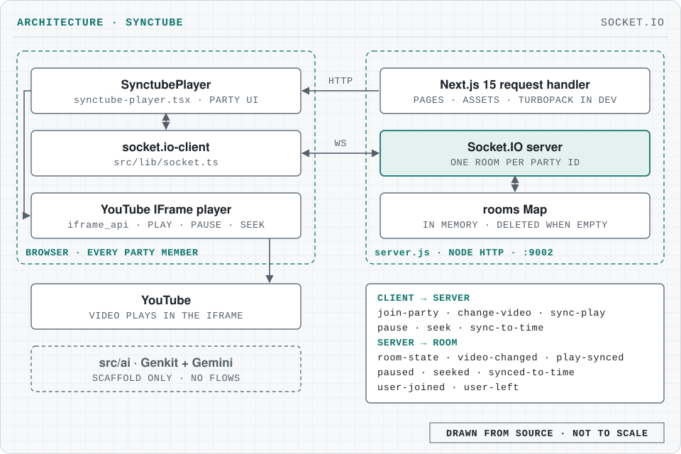

# SyncTube - Watch YouTube Together in Sync

Watch YouTube with friends in real time: one person hosts a party, others join with its ID, and playback stays in sync over Socket.IO.

[](https://nextjs.org/)
[](https://www.typescriptlang.org/)
[](https://socket.io/)
[](https://synctube-tau.vercel.app)


A real-time synchronized YouTube player that lets you watch videos with friends, perfectly in sync.

## What it does

1. One person creates a party and gets a unique party ID
2. Others join using that party ID
3. Anyone can load videos and control playback
4. All actions sync across everyone in the party in real-time

### Features

- **Real-time sync** - Everyone plays at the exact same time
- **Host controls** - First person creates the party and becomes host
- **Sync to position** - Bring everyone to your current timestamp
- **YouTube URL support** - Paste full URLs or video IDs
- **Party system** - Unique party IDs for private sessions
- **User presence** - See who's in the party

## Architecture

<picture>
  <source media="(prefers-color-scheme: dark)" srcset="docs/architecture-dark.svg">
  
</picture>

- **One process** ([server.js](server.js)). A Node HTTP server on port 9002 serves the Next.js 15 app through its request handler and hosts a Socket.IO server on the same port.
- **Rooms.** Each party ID is a Socket.IO room. Its state (video ID, playing or paused, current time, host, users) lives in an in-memory `Map`; the first user to join becomes host, and the room is deleted when the last user leaves.
- **Client** ([src/components/synctube-player.tsx](src/components/synctube-player.tsx)). The party UI drives a YouTube IFrame API player and a `socket.io-client` connection ([src/lib/socket.ts](src/lib/socket.ts)).
- **Sync.** Clients emit `join-party`, `change-video`, `sync-play`, `pause`, `seek` and `sync-to-time`. The server updates the room and broadcasts `room-state`, `video-changed`, `play-synced` (a shared start time), `paused`, `seeked`, `synced-to-time`, `user-joined` and `user-left`.
- **Scaffold.** [src/ai](src/ai) holds a Genkit + Gemini setup from the project template; it defines no flows and the app does not call it.

More detail on the events and the UI is in [PARTY_SYNC_SETUP.md](PARTY_SYNC_SETUP.md); the original design brief is [docs/blueprint.md](docs/blueprint.md).

## Tech stack

| Area | Tools |
|---|---|
| Framework | Next.js 15 (React 18, TypeScript) |
| Real-time | Socket.IO 4 (server in `server.js`, `socket.io-client` in the browser) |
| Player | YouTube IFrame API |
| UI | TailwindCSS + shadcn/ui (Radix UI), lucide-react |
| Hosting config | Firebase App Hosting ([apphosting.yaml](apphosting.yaml)) |
| CI | GitHub Actions: typecheck and build |

## Getting started

1. **Install dependencies:**
   ```bash
   npm install
   ```

2. **Run the development server:**
   ```bash
   npm run dev
   ```
   This starts `server.js` (Next.js plus Socket.IO). `npm run dev:next` starts Next.js alone on the same port, without sync.

3. **Open in browser:**
   - Go to `http://localhost:9002`
   - Create a party or join with a party ID
   - Share the party ID with friends
   - Load a YouTube video and click "Play Together"

The app itself needs no environment variables; `GEMINI_API_KEY` (see [.env.example](.env.example)) is read only by the Genkit scaffold under `npm run genkit:dev`. The browser connects to the Socket.IO server at `http://localhost:9002` (set in [src/lib/socket.ts](src/lib/socket.ts)), so party sync needs `server.js` running. Other scripts: `npm run build`, `npm run lint`, `npm run typecheck`.

## Project structure

```text
.
├── server.js                       # HTTP server: Next.js handler + Socket.IO rooms
├── src/
│   ├── app/                        # layout and the single page
│   ├── components/
│   │   ├── synctube-player.tsx     # party UI, YouTube player, socket events
│   │   └── ui/                     # shadcn/ui components
│   ├── lib/socket.ts               # socket.io-client singleton
│   ├── hooks/                      # toast, mobile
│   └── ai/                         # Genkit scaffold (unused)
├── docs/                           # blueprint and README images
├── PARTY_SYNC_SETUP.md
└── apphosting.yaml
```

## Screenshots

The create-party screen is shown at the top of this README; the live site is at [synctube-tau.vercel.app](https://synctube-tau.vercel.app).

Enjoy watching together! 🎉

## Licence

[MIT](LICENSE) © 2026 Rudra Prasadh Ganesh
