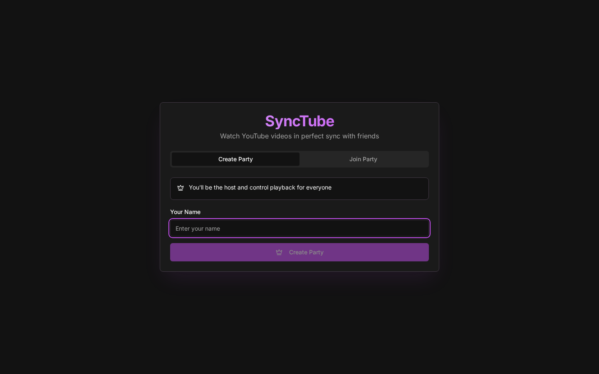

# SyncTube - Watch YouTube Together in Sync

Watch YouTube with friends in real time: one person hosts a party, others join with its ID, and playback stays in sync over Socket.IO.

[](https://nextjs.org/)
[](https://www.typescriptlang.org/)
[](https://socket.io/)
[](https://synctube-tau.vercel.app)



A real-time synchronized YouTube player that lets you watch videos with friends, perfectly in sync.

## 🚀 Quick Start

1. **Install dependencies:**
   ```cmd
   npm install
   ```

2. **Run the development server:**
   ```cmd
   npm run dev
   ```

3. **Open in browser:**
   - Go to `http://localhost:9002`
   - Create a party or join with a party ID
   - Share the party ID with friends
   - Load a YouTube video and click "Play Together"

## ✨ Features

- **Real-time sync** - Everyone plays at the exact same time
- **Host controls** - First person creates the party and becomes host
- **Sync to position** - Bring everyone to your current timestamp
- **YouTube URL support** - Paste full URLs or video IDs
- **Party system** - Unique party IDs for private sessions
- **User presence** - See who's in the party

## 🛠️ Tech Stack

- Next.js 15
- Socket.IO (real-time communication)
- YouTube IFrame API
- TailwindCSS + shadcn/ui

## 📝 How It Works

1. One person creates a party and gets a unique party ID
2. Others join using that party ID
3. Anyone can load videos and control playback
4. All actions sync across everyone in the party in real-time

Enjoy watching together! 🎉
